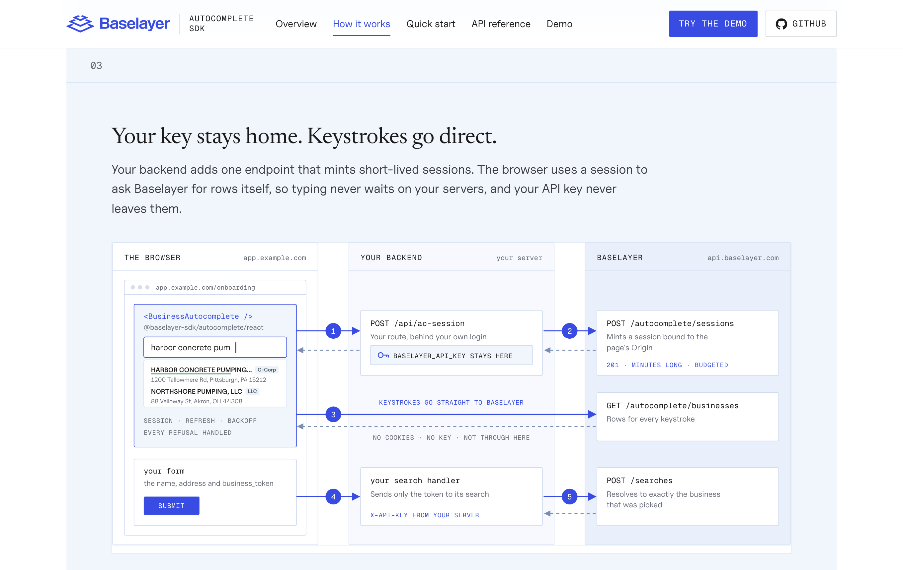
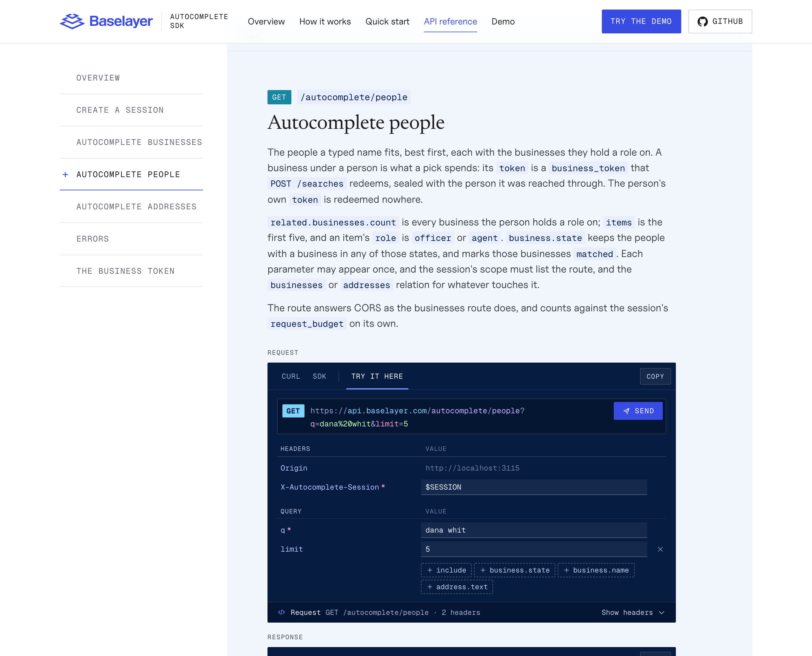

# The site

`site/` builds three static pages in Baselayer's brand:

| Page          | Path     | What                                               |
| ------------- | -------- | -------------------------------------------------- |
| Overview      | `/`      | the entities it searches, how it fits your backend |
| API reference | `/api/`  | the routes, generated from their specs             |
| Demo          | `/demo/` | the components against your own Baselayer account  |


The overview leads with what the autocomplete searches (businesses, people and
addresses; an entity not served yet runs past beside them, in a lane of its own)
and the component itself, playing: the real `BusinessAutocompleteView`, fed
made-up rows (`site/home/reel.ts`), types three business names a letter at a
time and picks the first row of each. It plays only while on screen, holds still
with reduced motion, and a toggle beside each moving part stops both. Then come
how each result links to the rest, and the integration in two diagrams: where
each piece runs, and every request from focus to submit in three swim lanes, for
the browser, your backend and Baselayer.



## The API reference is generated

Nothing on `/api/` is written by hand in the page. The build assembles one
OpenAPI 3.1 document and the page renders it: its sections come from the
document's tags, its fields from the schemas, its refusals from the
responses, and its examples from `examples` and `x-codeSamples`.

```text
contracts/autocomplete-openapi.json  GET /autocomplete/{route}    ─┐
contracts/sessions-openapi.json      POST /autocomplete/sessions  ─┤
contracts/autocomplete.overlay.yaml  what the specs lack          ─┘
                                                                   │ assemble
                          api/openapi.json  ◄── one document  ◄────┘
                          /api/             ◄── + Markdown rendered to HTML
```

- The two specs are the ones the API publishes, vendored (see
  [CONTRIBUTING](../CONTRIBUTING.md#contracts)). Every search route the
  autocomplete service's spec carries is documented, each under its own tag
  (Businesses, People, Addresses), which the overlay gives it.
- The overlay is an OpenAPI Overlay 1.0 holding what the specs do not say
  yet: the `Origin` rule, the refusal codes, examples. Each action says
  where upstream its text belongs; the goal is an empty overlay.
- `site/api/spec/assemble.ts` does the assembly; `site/api/spec/plugin.ts`
  renders the descriptions from Markdown at build time, so no Markdown
  parser ships to the browser, and publishes the document at
  `api/openapi.json` for anyone who wants it in Postman or a generator.
- A target the overlay names that no longer exists fails the build.

A nested model starts folded under its field, which says how many fields it
holds, unless it is small (three fields or fewer); `site/api/fieldTree.ts`
works out which rows belong to which.

### Try it here

Each operation's request block has a Try it here tab: the request as a form,
started from its curl sample (`site/api/TryIt.tsx`). The other samples follow
the form as it is edited (`site/api/snippets.ts`). Send makes the call from the
browser, and the answer shows in the response block as a Live tab.

It sends the way the demo does (see [the demo](demo.md)): under `pnpm site` it
goes to `/_baselayer/…` on the dev server, which forwards it to the API
`DEMO_API` names with the page's `Origin`, so no CORS list has to admit
localhost. So, to try it on localhost:

```sh
DEMO_API=sample pnpm site                     # made-up data, any key
DEMO_API=https://api.staging.example.test pnpm site   # a real API
```

Then open `/api/`, pick an operation, open Try it here and press Send. With a
real API the mint takes a real `X-API-Key`, which the form shows as typed,
since the field is not masked: use it only on a screen no one else sees. A
build sends to the URL the form shows, which a browser keeps from a page the
API does not admit.

The session is shared. A Create a session that succeeds leaves its token, when
it expires (counted from `expires_in`, as the API says to) and the request that
made it with the page (`site/api/session.tsx`), and the autocomplete routes'
forms start from it: `X-Autocomplete-Session` is the token, with a line under
it that says the session is active and how long it has, or that it has expired.
When Send finds it expired, the form mints a new one first, with that same
request and its `X-API-Key`, and says so in the bar; nothing mints in the
background, since sessions count against the organization's pools. A value
typed in the field is the reader's own and is sent as it is. The key is held in
memory only: a reload forgets it, and nothing is stored.



## Running it

```bash
pnpm site        # http://localhost:3000
pnpm demo        # the same server, opened on the demo
pnpm site:build  # site-dist/, static files
```

## Publishing under a Baselayer domain

`site-dist/` is plain static files: serve it from a bucket, a CDN or GitHub
Pages with a custom domain. Every link goes through the base path, so for a
sub-path build with it:

```bash
SITE_BASE=/autocomplete/ pnpm site:build
```

That is how the `Site` workflow publishes it: to GitHub Pages at
`sdk.baselayer.com`, the repository's custom domain, with the site under
`/autocomplete/` and `site/host-root/index.html` at the host's root, which
sends a visitor on to it. The host is for SDKs and the path for the
product.

The pages carry their own Content-Security-Policy and load nothing from a
third party; the fonts are self-hosted. Uncut Sans is baselayer.com's own
sans; Newsreader and Geist Mono stand in for its licensed serif and mono,
and can be swapped for them in `site/shared/brand.css` if the license covers
this site.

The demo on the published page calls the API from the browser, so its
origin must be on the API's CORS allowlist, for the mint and for the search
the demo's third step runs. The autocomplete service itself answers CORS for any
origin.
